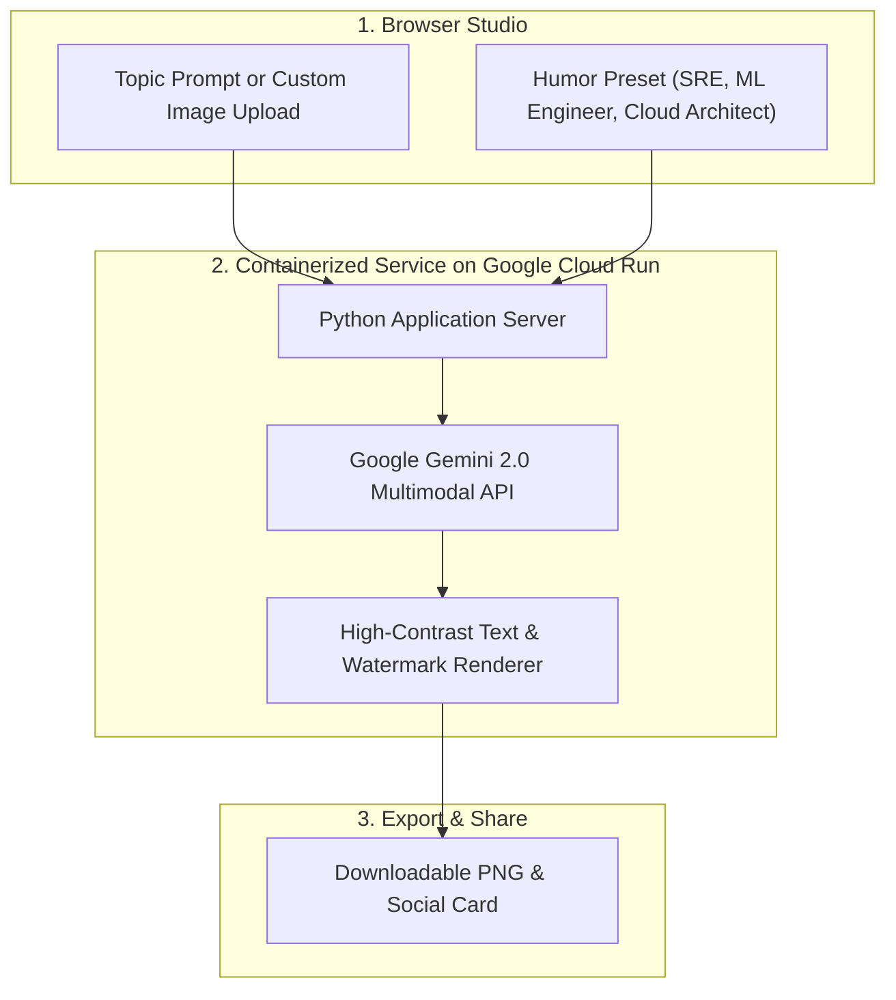

# Meme-Generator2025


> **Author & Architect:** [Robina Mirbahar](https://github.com/RobinaMirbahar) (Google Developer Expert in Cloud & AI)  
> **Focus:** Next-Gen AI Multimodal Meme Studio Powered by Google Gemini 2.0 & Serverless Google Cloud Run

---

## 🎯 Why I Built Meme Studio 2025 — Cloud-Native Multimodal Edition (Engineering Purpose & Real-World Value)

### 1. ✨ Upgrading to Gemini 2.0 Native Multimodal Understanding
In this 2025 edition, I upgraded my original meme pipeline to leverage Gemini 2.0's faster multimodal reasoning, visual scene understanding, and multi-style humor presets.

### 2. ☁️ Containerized for One-Command Cloud Run Deployment
I packaged the application with a production `Dockerfile` so workshops and community events can spin up a live shared URL with scale-to-zero serverless hosting.

### 3. 🎨 Custom Template Upload & Batch Generation
Users can upload custom event photos or architecture diagrams and generate multiple witty variations simultaneously.

---

## 🏗️ System Architecture



---

# Ultimate Meme Generator 🚀

An AI-powered meme generator with multiple art styles and animation effects, built with Google Cloud Vertex AI and Python.

 *(example demo gif would go here)*

## Features ✨

- 🖼️ **AI Image Generation** - Create images from text prompts
- 🎨 **Multiple Art Styles**:
  - Photorealistic
  - Cartoon/Pixar
  - Digital Art
  - Watercolor
  - Cyberpunk
- ✏️ **Custom Text Overlays** with multiple positioning options
- 🎬 **Animation Effects**:
  - Fade-in
  - Slide-up
  - Typing effect
- 💾 **Export Options**:
  - Static JPEG
  - Animated GIF
- 🎨 **Customizable Colors** for text and outlines

## Google Colab Access ▶️

[](https://colab.research.google.com/drive/1ERUAN61C0Ab3C-2AYwC6a2gT0GFOhE3S#scrollTo=cEZ0bhSQKRzq)

1. Click the "Open in Colab" button above
2. When prompted, connect to a Google Cloud project with Vertex AI enabled
3. Run all cells sequentially (Runtime > Run all)
4. Use the interactive widget to create your memes!

## Prerequisites 🔧

- Google Cloud account with Vertex AI enabled
- Google Cloud project with billing enabled
- Basic knowledge of Google Colab

## Setup Instructions ⚙️

1. **Enable APIs**:
   - Go to [Google Cloud Console](https://console.cloud.google.com/)
   - Enable "Vertex AI API" for your project

2. **Authentication**:
   - The notebook will automatically prompt for authentication
   - Follow the OAuth flow when prompted

3. **Configuration**:
   - Set your `PROJECT_ID` in the configuration cell
   - Choose your preferred `LOCATION` (default: us-central1)

## Usage Guide 📖

1. **Describe your image** in the first text box
   - Be specific! (e.g., "a cat wearing sunglasses on a beach")
   
2. **Customize your meme**:
   - Choose art style
   - Add your meme text
   - Select text position and colors
   - Pick animation style (or none for static)

3. **Generate & Download**:
   - Click "Generate Meme" button
   - Wait 20-40 seconds for processing
   - Download your creation with the download button

## Troubleshooting ⚠️

**Common Issues**:

1. *Authentication errors*:
   - Make sure you're logged into the correct Google account
   - Check that the account has access to the GCP project

2. *API not enabled*:
   - Verify Vertex AI API is enabled in your project
   - Visit: https://console.cloud.google.com/apis/library/aiplatform.googleapis.com

3. *Image generation fails*:
   - Try a different prompt
   - The system will automatically use fallback images if generation fails

## Code Structure 🧱

The system is organized into 6 main steps, each handling a specific functionality:

### 1. Installation & Authentication (`!pip install` + `auth`)
```python
!pip install -q google-cloud-aiplatform pillow requests matplotlib ipywidgets imageio
from google.colab import auth
auth.authenticate_user()
Installs required packages quietly

Handles Google Cloud OAuth2 authentication

Uses Colab's built-in auth flow

2. Configuration (PROJECT_ID + LOCATION)
PROJECT_ID = "your-project-id"  # GCP Project with Vertex AI enabled
LOCATION = "us-central1"        # Vertex AI service region

Centralized configuration for GCP services

Region selection impacts latency/cost

3. Client Initializationfrom google.cloud import aiplatform
from google.cloud.aiplatform_v1 import PredictionServiceClient

client_options = {"api_endpoint": f"{LOCATION}-aiplatform.googleapis.com"}
client = PredictionServiceClient(client_options=client_options)
Sets up Vertex AI prediction client

Automatic retry logic built-in

Regional endpoint configuration

4. Image Generation Core (generate_image())
def generate_image(prompt, style="photo", retries=3):
    # Style configurations (photo/cartoon/art/watercolor/cyberpunk)
    # API request construction
    # Response handling with error retries
Style-specific prompt engineering

Built-in retry mechanism (3 attempts)

Automatic quality validation

Fallback image system

5. Text Overlay Engine (add_meme_text())
def add_meme_text(img, text, position="bottom", ...):
    # Font handling with fallback
    # Dynamic text wrappingProfessional meme text styling

4 animation effects

Dynamic font sizing

Cross-platform font handling

6. Interactive UI (create_meme_with_widgets())

def create_meme_with_widgets():
    # Widget creation (text inputs, dropdowns, color pickers)
    # Real-time preview system
    # Generation pipeline orchestration
    # Download handler
    # Animation effects (fade/slid
    Complete GUI with ipywidgets

Responsive layout

Live color previews

One-click download

Execution Flow
User inputs → Widgets capture parameters

Vertex AI generates base image

Text overlay applied with effects

Results rendered as JPEG/GIF

Download ready meme

Key Dependencies
Package	Purpose
google-cloud-aiplatform	Vertex AI image generation
pillow	Image processing/text overlay
ipywidgets	Interactive UI components
imageio	GIF animation handling
matplotlib	Image display in Colab

## Verification Commands 🔍

Use these commands in Colab to check your setup before generating memes:

### 1. **Authentication Check**
```python
from google.colab import auth
from google.cloud import aiplatform

# Verify authentication
try:
    auth.authenticate_user()
    print("✅ Authentication successful!")
except Exception as e:
    print(f"❌ Authentication failed: {str(e)}")
```

### 2. **Project Access Test**
```python
# Check project access
from google.cloud import aiplatform_v1

client_options = {"api_endpoint": f"{LOCATION}-aiplatform.googleapis.com"}
client = aiplatform_v1.PredictionServiceClient(client_options=client_options)

try:
    models = client.list_models(parent=f"projects/{PROJECT_ID}/locations/{LOCATION}")
    print(f"✅ Project {PROJECT_ID} accessible")
    print(f"Available models: {list(models)}")
except Exception as e:
    print(f"❌ Project access error: {str(e)}")
```

### 3. **Model Availability Check**
```python
# Test image generation model access
try:
    endpoint = f"projects/{PROJECT_ID}/locations/{LOCATION}/publishers/google/models/imagegeneration"
    test_request = {
        "instances": [{"prompt": "test"}],
        "parameters": {"sampleCount": 1}
    }
    client.predict(endpoint=endpoint, instances=test_request)
    print("✅ Image generation model available")
except Exception as e:
    print(f"❌ Model access error: {str(e)}")
```

### 4. **Package Verification**
```python
# Verify critical packages
import importlib

required_packages = [
    ('PIL', 'pillow'),
    ('google.cloud.aiplatform', 'google-cloud-aiplatform'),
    ('imageio', 'imageio'),
    ('ipywidgets', 'ipywidgets')
]

for (module_name, pkg_name) in required_packages:
    try:
        importlib.import_module(module_name)
        print(f"✅ {pkg_name} installed")
    except ImportError:
        print(f"❌ {pkg_name} missing - run: !pip install {pkg_name}")
```

### 5. **Quick Health Check**
```bash
# One-line system check
!python -c "from google.colab import auth; auth.authenticate_user(); \
from google.cloud import aiplatform; print('✔️ Colab ready for meme generation')"
```

### Usage Tips:
1. Run these **before** your first generation attempt
2. If any check fails:
   - Reauthenticate: `auth.authenticate_user()`
   - Verify billing is enabled for your GCP project
   - Check [Vertex AI API status](https://status.cloud.google.com/)
3. For package issues: `!pip install --upgrade google-cloud-aiplatform pillow`


## AI Models Used 🤖

This application leverages Google Vertex AI's foundation models with specialized configurations:

### 1. **Primary Image Generation Model**
**Model Name**: `imagegeneration@002`  
**Publisher**: Google  
**Capabilities**:
- Text-to-image generation
- Style transfer
- Resolution enhancement

**Technical Specs**:
| Parameter | Value | Description |
|-----------|-------|-------------|
| Max Resolution | 1024x1024 | Square aspect ratio |
| Inference Time | 15-30 sec | Varies by prompt complexity |
| Supported Styles | 5 predefined | Photo, Cartoon, Art, Watercolor, Cyberpunk |

**Prompt Engineering**:
```python
# Example payload to Vertex AI
{
  "instances": [
    {
      "prompt": "Cyberpunk neon-lit scene of a cat, futuristic, rain, glowing lights, 4K detailed",
      "negativePrompt": "daylight, sunny, natural lighting, blurry"
    }
  ],
  "parameters": {
    "sampleCount": 1,
    "style": "cyberpunk",
    "guidanceScale": 13  # Strict prompt adherence
  }
}
```

### 2. **Style-Specific Configurations**
Each style uses the base model with optimized parameters:

| Style | Guidance Scale | Key Prompt Modifiers | Negative Prompts |
|-------|---------------|-----------------------|------------------|
| Photo | 12 | "8K UHD, sharp focus, natural lighting" | blurry, cartoon, drawing |
| Cartoon | 10 | "Pixar-style 3D animation, vibrant colors" | realistic, photo, blurry |
| Art | 11 | "digital painting, artstation, trending" | photo, blurry, low quality |
| Watercolor | 9 | "soft edges, artistic composition" | digital, sharp edges |
| Cyberpunk | 13 | "neon-lit, futuristic, rain, glowing" | daylight, sunny |

### 3. **Model Limitations**
- **Content Policy**: Filters NSFW content automatically
- **Max Prompt Length**: 500 characters
- **Rate Limits**: 60 requests/minute per project
- **Supported Regions**: `us-central1`, `europe-west4`, `asia-east1`

### Verification Command
Check available models in your project:
```python
from google.cloud import aiplatform_v1

client = aiplatform_v1.ModelServiceClient()
models = client.list_models(parent=f"projects/{PROJECT_ID}/locations/{LOCATION}")

print("Available models:")
for model in models:
    if "imagegeneration" in model.display_name.lower():
        print(f"- {model.display_name} (ID: {model.name.split('/')[-1]})")
```

### How to Access
1. Ensure Vertex AI API is enabled:
   ```bash
   !gcloud services enable aiplatform.googleapis.com --project={PROJECT_ID}
   ```
2. Verify model availability:
   ```python
   !gcloud ai models list --region={LOCATION} --project={PROJECT_ID} | grep imagegeneration
   ```

### Cost Considerations
- $0.016 per image (1024x1024)
- Free tier: 1000 images/month (for eligible projects)
- [Pricing Calculator](https://cloud.google.com/vertex-ai/pricing#generative_ai)


---

### 🚀 Featured Google Cloud & Agentic AI Portfolio by Robina Mirbahar

| Repository | Architecture & Focus | Live Status |
| :--- | :--- | :--- |
| **[gemma4-multilora-adk-eval](https://github.com/RobinaMirbahar/gemma4-multilora-adk-eval)** | Dynamic Multi-LoRA Hot-Swapping & CI/CD Agent Evaluation (`adk eval`) on Cloud Run GPUs with Gemma 4 & vLLM |   |
| **[slothsre-napops](https://github.com/RobinaMirbahar/slothsre-napops)** | SlothSRE ("NapOps") — Overnight Gemma 4 & Google ADK Incident Digest Agent with OpenTelemetry & Sentry AI Monitoring |   |
| **[streamforge-event-adk](https://github.com/RobinaMirbahar/streamforge-event-adk)** | Real-Time Event-Driven Multi-Agent Pipelines on Google Cloud with ADK (`ParallelAgent` & `LoopAgent`), Eventarc & Pub/Sub |   |
| **[a2a-mcp-mesh-cloudrun](https://github.com/RobinaMirbahar/a2a-mcp-mesh-cloudrun)** | Agent-to-Agent (A2A) & Multi-MCP Mesh on Cloud Run with Gemma 4, Google ADK, Spanner Graph & AlloyDB |   |
| **[cloudguard-gemma-agent](https://github.com/RobinaMirbahar/cloudguard-gemma-agent)** | 6-Part Production Gemma Enterprise Agent Series (ADK, Cloud Run L4 GPU, Firestore, Model Armor, Vertex AI QLoRA) |   |
| **[Comic-Studio-Ai](https://github.com/RobinaMirbahar/Comic-Studio-Ai)** | Multi-Agent Comic Generator powered by Google Gemini API & FastAPI deployed on Google Cloud Run |   |
| **[vertex-ai-imagen3](https://github.com/RobinaMirbahar/vertex-ai-imagen3)** | Generate AI-powered product & editorial images using Google Vertex AI Imagen 3 in Google Colab |   |
| **[Python-Learning-Assistant](https://github.com/RobinaMirbahar/Python-Learning-Assistant)** | AI-powered Python tutor covering 50+ interactive exercises with real-time feedback built with Streamlit + Gemini API |   |
| **[cozy-ai-agent-cafe-game](https://github.com/RobinaMirbahar/cozy-ai-agent-cafe-game)** | Prompt Paws: 60 FPS Cozy AI Agent Bakery Simulation Game teaching RAG, Guardrails, Context Caching & Multi-Agent Loops |   |

<div align="center">
  
</div>

<!-- AUTHOR_SIGNATURE_START -->
---

## 👩‍💻 About the Author

**Robina Mirbahar — Google Cloud & AI Architect**  
*Google Developer Expert (GDE) in Cloud & AI • Published Author • Multi-Agent Systems & Serverless GPU Builder*

[](https://github.com/RobinaMirbahar)
[](https://medium.com/@robinamirbahar)
[](https://dev.to/robinamirbahar)
[](https://www.linkedin.com/in/robina-mirbahar)
[](https://g.dev/RobinaMirbahar)
[](https://www.youtube.com/@RobinaMirbahar)
[](https://x.com/RobinaMirbahar)
[](https://www.amazon.com/dp/B0D146249R)

<!-- AUTHOR_SIGNATURE_END -->
